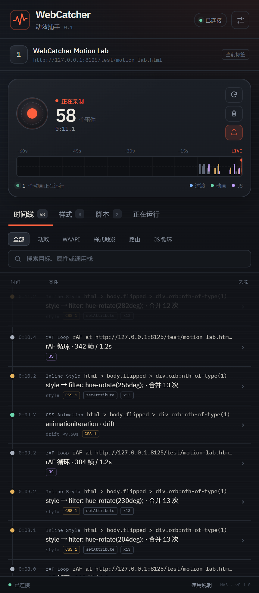
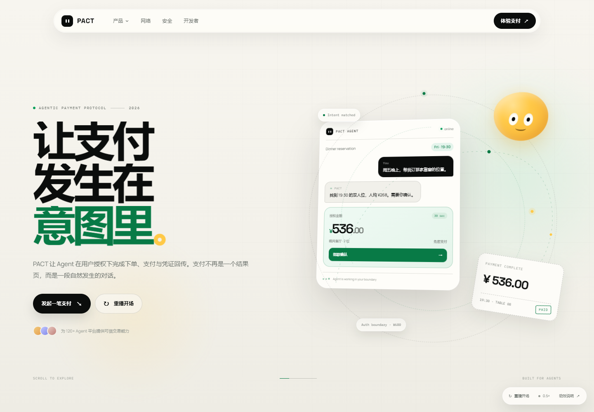

# WebCatcher · 动效捕手

一个运行在 Chrome 侧边栏里的网页动效取证工具。它实时读取当前标签页，在不打断页面的前提下记录 CSS 动画、过渡、Web Animations API、View Transitions、JS 动画循环，以及触发它们的代码位置和样式来源。

做这个工具的目标很直接：看到一个喜欢的网页转场或交互动效时，不必猜它是 CSS 还是 JS 写的，打开 WebCatcher 就能看到调用栈、关键帧、缓动曲线和源码片段。

 



## 功能

- **实时时间线**：记录 transition、animation、WAAPI、类名 / 内联样式变化、CSSOM 注入、路由跳转和 rAF 循环。
- **暂停 / 继续**：侧边栏按钮或 `Alt + Shift + R` 随时冻结记录，方便在关键帧处观察页面。
- **CSS 实现提取**：抓取内联样式、同源样式表，并通过扩展后台拉取跨域 CSS；自动提取 `@keyframes`、transition 规则、View Transition 规则和滚动驱动动画。
- **JS 实现线索**：分析页面脚本与动态插入脚本，按动效关键词评分，给出源码片段、行号和脚本地址；识别 GSAP、anime.js、Motion、Lottie、Three.js、Swup、Barba.js、Turbo、Astro 等常见库与页面转场方案。
- **运行时调用栈**：对 `Element.animate()`、`startViewTransition()`、GSAP、内联样式写入和 CSSOM 修改记录调用栈。
- **正在运行**：查看当前页面中所有 animation 的播放状态、时间、目标元素、关键帧和 timing。
- **导出**：把当前会话导出为 Markdown 报告或完整 JSON。

## 安装（开发者模式）

1. 打开 `chrome://extensions/`。
2. 打开右上角的「开发者模式」。
3. 点击「加载已解压的扩展程序」，选择本仓库目录。
4. 打开任意网页，点击工具栏中的 WebCatcher 图标。Chrome 会在右侧打开工作台。

> 需要 Chrome 114 或更高版本。扩展不使用远程代码，也没有构建步骤。

## 使用

1. 打开目标网页，再打开 WebCatcher 侧边栏。
2. 正常操作页面：悬停、点击、滚动、切换路由。
3. 在「时间线」里查看运行时事件；点开一行可以看到目标元素、调用栈、匹配到的样式和计算样式快照。
4. 在「样式」里按类型查看 `@keyframes` / transition / view-transition 的完整代码。
5. 在「脚本」里查看动效相关脚本及命中关键词的代码片段。
6. 需要定格观察时点击暂停按钮，或按 `Alt + Shift + R`；继续后录制会接着累积。

## 捕获范围

| 能力 | 实现方式 |
| --- | --- |
| CSS transition / animation 事件 | 页面主世界事件监听 |
| `Element.animate()` | 包装 Web Animations API |
| `document.startViewTransition()` | 包装 View Transitions API |
| 类名 / 内联样式变化 | MutationObserver + CSSStyleDeclaration 包装 |
| CSSOM 动态注入 | 包装 `insertRule` / `replaceSync` / `adoptedStyleSheets` |
| rAF 动画循环 | 聚合调用栈与帧耗时，避免逐帧刷屏 |
| GSAP / anime.js | 运行时包装全局 API |
| 页面跳转 | History API、`popstate`、`hashchange`、Navigation API |
| CSS 源码 | CSSOM 读取 + 后台抓取跨域样式表 |
| JS 源码 | 后台抓取脚本 + 内联脚本 DOM 文本 + 关键词分析 |

## 已知限制

- 浏览器扩展无法获取页面已经执行完的历史 JS 调用；WebCatcher 记录的是安装之后发生的调用。若要看页面加载动画，请在打开页面前就打开侧边栏，或刷新页面。
- CSS 与 JS 的静态源码分析是启发式的，面向学习定位，不是完整 AST 分析。
- 跨域脚本通过 `fetch` 读取；极少数带特殊鉴权的资源可能抓取失败。
- 不进入浏览器 DevTools 协议，因此不会出现 “正在调试此浏览器” 的提示，也不会暂停页面执行。
- 暂不解析 source map，行号对应编译后的文件。

## 隐私

所有数据只保存在当前浏览器会话的 `chrome.storage.session` 中，不会上传到任何服务器。扩展仅在用户主动打开工作台时读取当前标签页的动效信息。清除会话按钮会清空事件和源码分析结果。

## 目录

```text
manifest.json          # MV3 清单
background.js          # 会话、源码抓取、CSS/JS 分析、消息路由
content/recorder.js    # 页面主世界（MAIN world）运行时探针
content/bridge.js      # 隔离世界消息桥
lib/                   # CSS 解析、JS 分析、导出与格式化
panel.html/css/js      # 侧边栏工作台
assets/                # 扩展图标
```

## 开发

没有构建步骤。修改文件后，在 `chrome://extensions/` 点击本扩展的刷新按钮即可。

```powershell
git clone https://github.com/jxy162/webcatcher.git
cd webcatcher
# chrome://extensions -> 加载已解压的扩展程序 -> 选择本目录
```

## 测试

```powershell
npm run check
npm test
```

端到端测试会启动 Edge，加载未打包扩展，打开测试页并验证捕获、暂停/继续、详情抽屉和来源列表：

```powershell
npm install
npm run test:e2e
```

默认使用 Windows 上的 Edge。其他环境可设置 `BROWSER_BIN` 指向 Chrome/Edge 可执行文件。测试截图输出到 `test/artifacts/`。

## 示例页面

`demo/agent-pay/` 是根据本次捕获记录重制的独立动效示例，包含开场 SVG 路径绘制、滚动 reveal、对话支付流程、Agent 眨眼、网络绘制和 3D 卡片倾斜等动画。



直接用浏览器打开 `demo/agent-pay/index.html`，或在仓库根目录执行 `npx serve demo/agent-pay` 后访问本地地址。

## 性能策略

WebCatcher 会根据侧边栏状态自动切换采集精度：

- **轻量录制**：侧边栏未打开时，只保留 transition、animation、WAAPI、View Transition、路由和动画库调用等核心事件，不扫描 DOM、不做计算样式快照、不抓取外部 CSS/JS。
- **完整录制**：侧边栏打开后才启用样式/类名变化、调用栈、命中 CSS、关键帧快照、外部源码抓取和网络资源分析。
- **高频合并**：连续写入同一元素同一属性的 rAF 样式更新会合并记录。
- **环形缓存**：事件超出上限会自动丢弃最旧记录；较旧事件压缩掉大字段，保留时间线和摘要。
- **有界缓存**：源码、分析结果、复制内容和面板事件都有容量上限，避免长时间录制持续吃内存。

如果发现某个页面仍然很重，可以先暂停录制，或在侧边栏里只保留当前需要排查的时间段。

## License

MIT
